# boorubot

[](https://github.com/mrlptrc/boorubot/actions/workflows/testes.yml)


> **In English:** boorubot is a local web panel that helps an artist post her artwork to imageboards
> (Danbooru, rule34.paheal, rule34.xxx) at a steady pace of one per day. A local AI tagger suggests
> Danbooru-style tags and rating, she reviews and approves, and a queue publishes through the Danbooru API,
> a headless browser, or an assisted manual flow where a site blocks automation. The UI is in Portuguese.

Painel local para artistas publicarem as próprias artes em imageboards (Danbooru, rule34.paheal e rule34.xxx),
**uma por dia**, sem copiar e colar a mesma arte em vários sites.

A artista sobe a arte, a Mochi (um tagger que roda no próprio PC) sugere tags e rating no padrão do Danbooru,
ela revisa e aprova. A arte entra numa fila e o robô publica uma por dia, no horário escolhido, em cada site marcado.

<p align="center">
  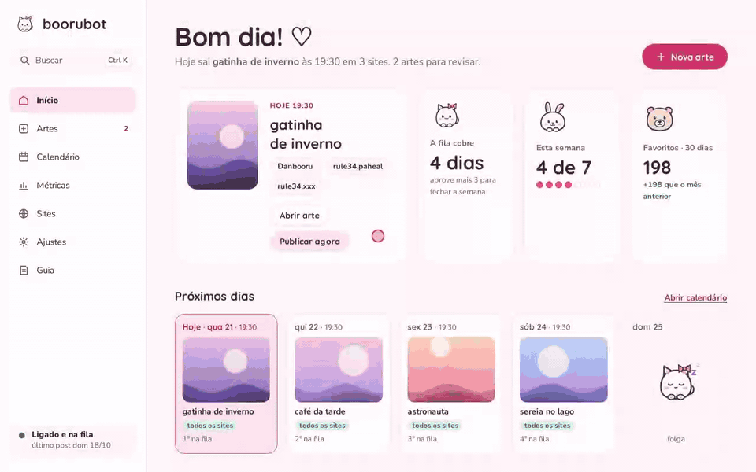
</p>

<p align="center"><sub>Rascunho → tags da Mochi → rating → aprovar → a arte ganha um dia no calendário. Dados de demonstração.</sub></p>

| Site | Como publica | Login |
|---|---|---|
| Danbooru | API oficial (`/uploads.json` → `/posts.json`) | chave de API, cadastrada no painel |
| rule34.paheal | formulário web via Playwright, sem janela; lista de tags própria por arte (só série, personagem e artista, que é o que o site aceita) | Sites → Entrar (uma vez) |
| rule34.xxx | **envio assistido**: a Cloudflare do site recusa navegador automatizado, então o painel prepara arte, tags, rating e fonte e a pessoa envia pelo próprio navegador | no navegador de quem usa |

Gelbooru ficou de fora porque já copia sozinho os posts do Danbooru (pela conta "danbooru"); mandar de novo
criaria duplicata. rule34.us ficou de fora porque o formulário de envio do site não manda o arquivo.

## Princípios

- **Teste e produção nunca se misturam.** "Testar este post" grava só em `test_runs` e não mexe em fila,
  status nem ritmo; `publications` guarda só envios reais; com o modo teste ligado a produção fica bloqueada.
- **Captcha é sempre resolvido por uma pessoa.** Nada de serviço de captcha, proxy ou truque contra anti-bot.
  Quando um site barra o navegador automatizado, o caminho é o envio assistido, não disfarçar o robô.
- **Fila com limitador de ritmo.** Arte aprovada tem posição, não data; no máximo 1 por dia, 12 h entre posts,
  e atraso (PC desligado ou dormindo) não acumula.
- **Tudo fica no computador de quem usa.** Banco, imagens, chaves e sessões dos sites ficam em pastas locais
  fora do git (`data/`, `.profiles/`, `runs/`).

## Instalação

Precisa de [uv](https://docs.astral.sh/uv/) (ele baixa o Python 3.13 se faltar).

**Windows**, na pasta do projeto, no PowerShell:

```powershell
powershell -ExecutionPolicy Bypass -File scripts\instalar-windows.ps1
```

Instala o uv (se faltar), as dependências e o Chromium do Playwright, deixa o painel abrindo escondido
quando o Windows liga e abre o painel em http://127.0.0.1:8765. Pode rodar de novo sem problema.

**Linux / macOS:**

```bash
uv sync
uv run playwright install chromium
uv run boorubot panel
```

Depois, no painel:
1. Siga o **Guia** (menu lateral): ele começa no **modo teste**, em que nada é publicado.
2. **Sites → Danbooru**: login e chave de API. **Sites → paheal → Entrar**: login uma vez no navegador do robô.
3. **Ajustes**: horário do post diário, tags padrão (ex.: a tag de artista), sites padrão e pasta de backup.
4. Deixe o PC **sem dormir na tomada** no horário do post: PC dormindo = post atrasado até ele acordar.

Rode **um painel por conta**: dois painéis com as mesmas contas publicam em dobro.

A primeira sugestão de tags baixa ~380 MB (modelo [`SmilingWolf/wd-vit-tagger-v3`](https://huggingface.co/SmilingWolf/wd-vit-tagger-v3)).

## O painel

- **Início**: o que sai hoje, quantos dias a fila cobre, um aviso por vez (login caído, backup falhando,
  envio à mão do dia, modo teste), os próximos 7 dias e o que falta revisar.
- **Nova arte / editor**: arraste a arte, a Mochi sugere tags e rating, revise, marque os sites e aprove.
  "Testar sem publicar" simula cada site (o Danbooru envia de verdade ao testbooru se houver conta de teste).
- **Artes**: tudo o que já subiu, com a situação em cada site.
- **Calendário**: semana × site com a arte prevista em cada dia. Arrastar muda a posição na fila; o menu
  de cada site muda o ritmo dele (1 por dia, N dias depois, dia sim dia não, desligado).
- **Métricas**: favoritos e score do Danbooru por arte, semana e site.
- **Sites**: contas, sessão de cada site e envio assistido.
- **Ajustes**: horário, tags e sites padrão, modo teste, início automático e backup.
- **Ctrl+K** busca artes, páginas e ações. Funciona no celular (barra de navegação embaixo).

### Telas

| Início | Editor da arte |
|---|---|
| 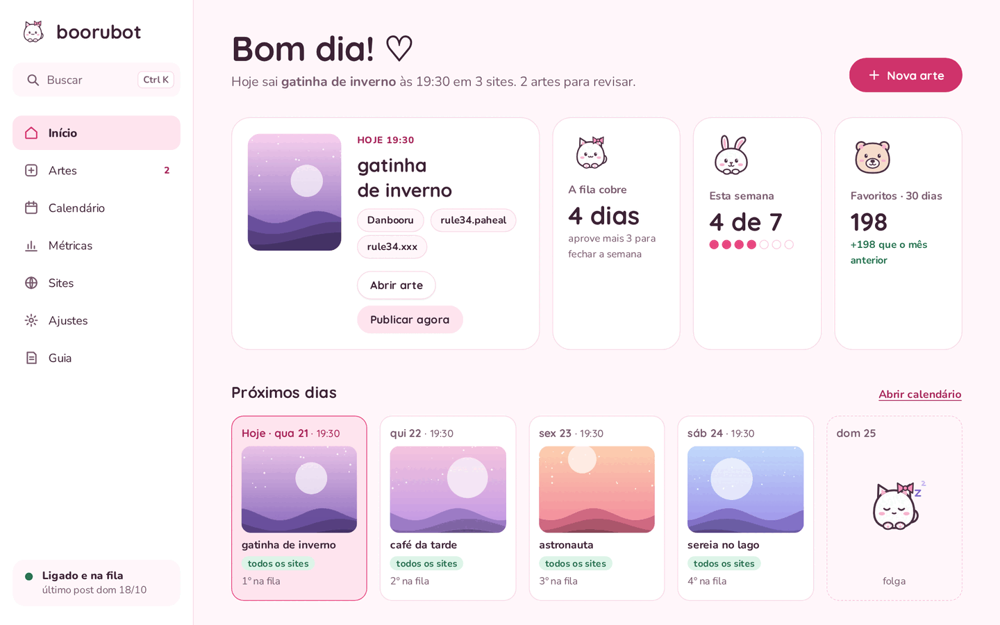 | 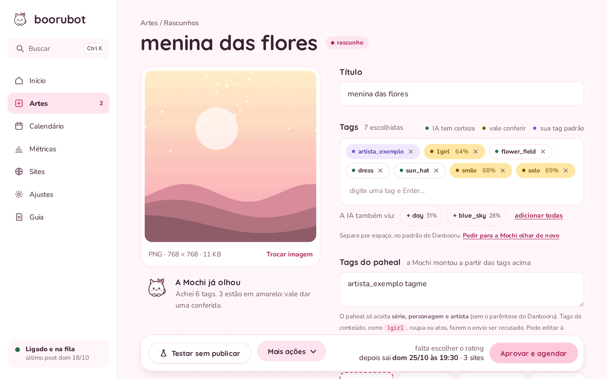 |
| **Calendário** | **Métricas** |
| 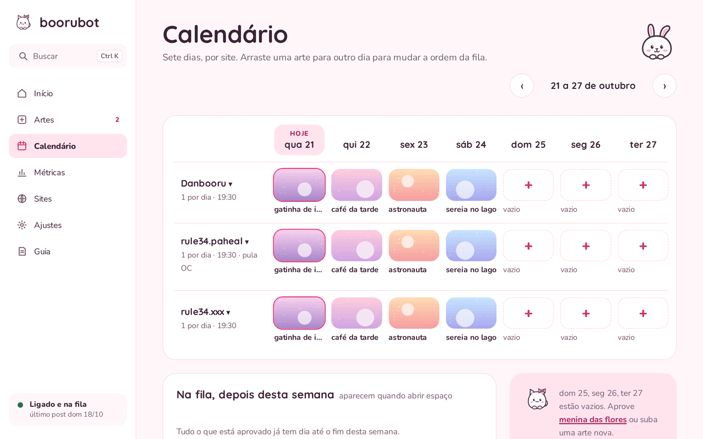 | 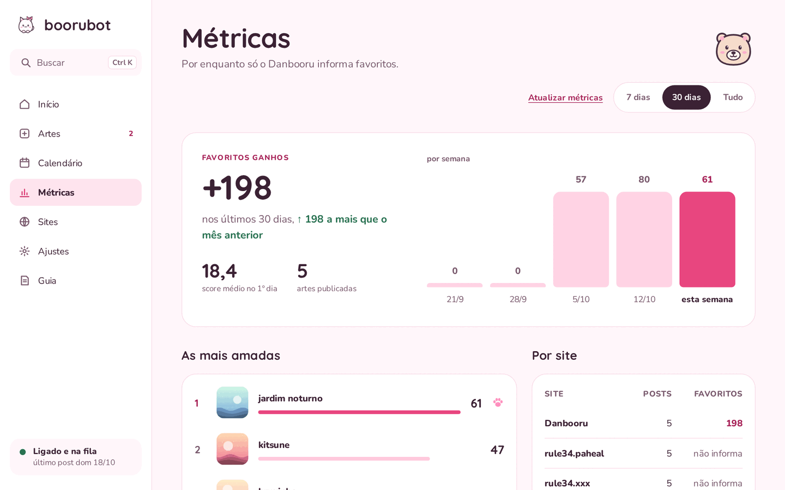 |
| **Artes** | **Sites** |
| 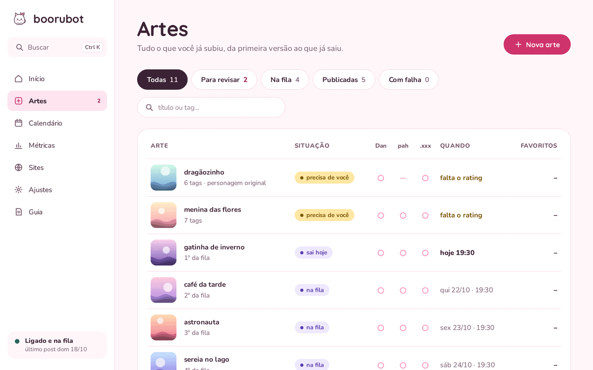 | 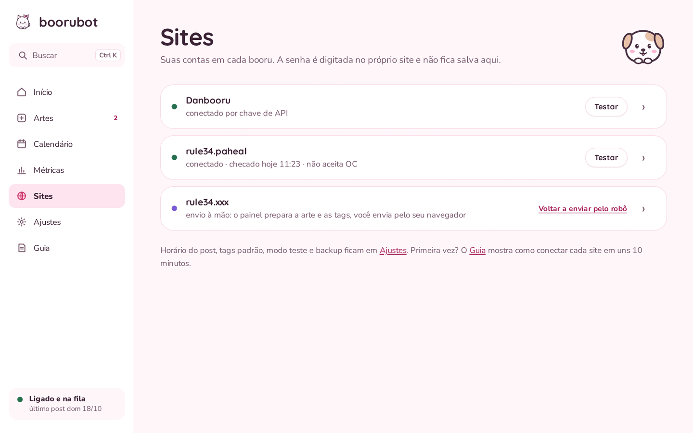 |

<p align="center">
  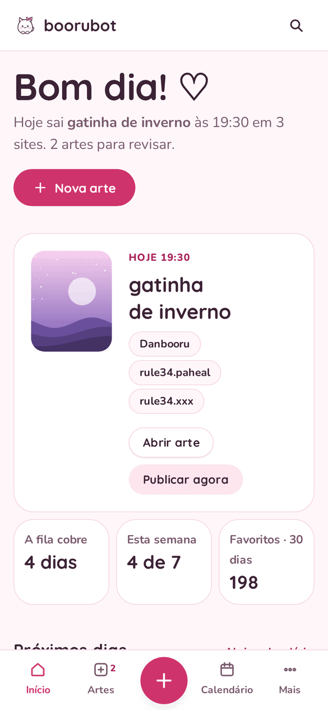
  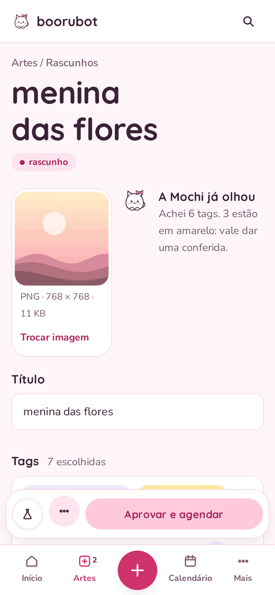
  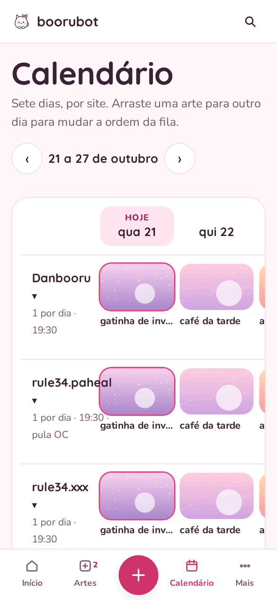
</p>

Os prints e o GIF usam um banco de demonstração com artes geradas por código. Para refazer depois de mudar
alguma tela: `scripts/demo/gerar.sh` (precisa de ffmpeg e ImageMagick).

## Como funciona

Um processo só, no PC de quem usa: o painel web e três threads de fundo dividem o mesmo banco SQLite.

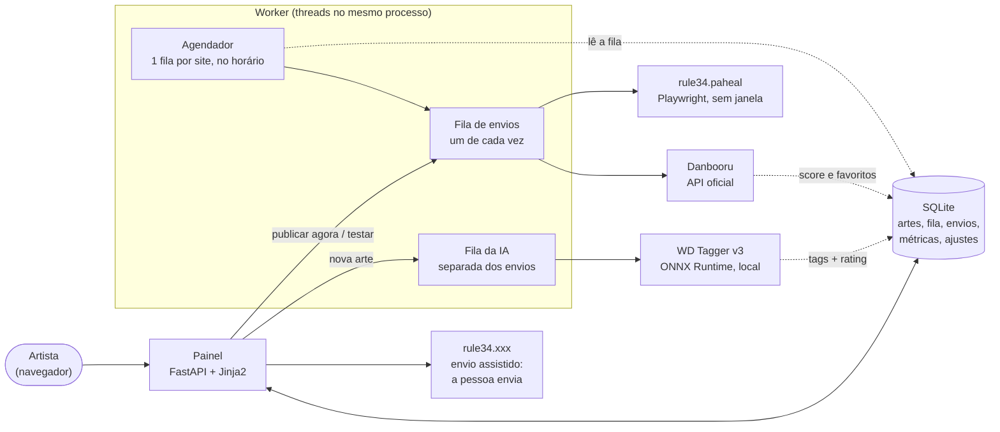

Decisões que moldam o código:

- **Uma simulação para o robô e para as telas.** `scheduler.simulate_site` percorre a fila de cada site dia a
  dia. O worker pergunta a ela o que sai agora (`site_due`), e o Início e o Calendário usam a mesma função para
  mostrar o que vai sair (`plan`). A previsão na tela é sempre o que o robô vai fazer.
- **Fila com posição, não com data.** Arte aprovada tem `queue_pos`. O dia de cada arte é calculado na hora,
  então reordenar, pular um dia ou o PC ficar desligado não deixa datas velhas no banco nem acumula posts.
- **A IA nunca atrasa um envio.** A sugestão de tags roda numa fila e numa thread próprias. O primeiro uso
  baixa ~380 MB e cada análise leva segundos; o envio das 19:30 não espera por isso.
- **Envios um de cada vez.** Os sites de formulário usam perfis persistentes do Playwright (`.profiles/`), e
  dois envios ao mesmo tempo brigariam pelo mesmo perfil.
- **Teste e produção em tabelas diferentes.** `test_runs` e `publications` nunca se misturam, então um teste
  não conta como publicação, não mexe na fila e não estraga métricas.
- **Quando o site barra o robô, a pessoa assume.** A Cloudflare do rule34.xxx recusa navegador automatizado.
  Em vez de disfarçar o robô, o painel prepara tudo e a pessoa envia; o resto da fila segue normal.
- **Banco que se atualiza sozinho.** As migrações rodam em `DB.__init__` e são idempotentes: abrir uma versão
  nova do painel sobre um banco antigo só adiciona o que falta.

## Comandos

```bash
uv run boorubot panel [--no-browser] [--port 8765]   # se já estiver rodando, só abre o navegador
uv run boorubot startup install|remove|status        # início automático com o Windows (.vbs na pasta Inicializar)
uv run boorubot check [site...] [--headed]           # reconhecimento dos sites, sem credenciais
uv run boorubot login paheal                         # abre o navegador do robô para login (e captcha)
uv run boorubot discover paheal                      # logado: salva os campos reais do formulário em runs/
uv run boorubot post queue/exemplo-001               # CLI: dry-run de um post com o .env (testbooru)
uv run pytest
```

O `.env` (veja `.env.example`) é só para a CLI. O painel usa as contas cadastradas nele.

## Pastas locais (fora do git)

- `data/`: banco SQLite (fila, histórico, métricas, configurações) e imagens. É o que vai para o backup.
- `.profiles/`: sessões logadas dos sites (cookies). Não vai para o backup; se perder, é só entrar de novo.
- `runs/`: `panel.log` (com rotação) e prints e diagnóstico de cada execução.

Para mudar de computador, copie a pasta do projeto com `data/` junto, rode a instalação no novo, entre de novo
nos sites e desligue o painel do computador antigo.

## Desenvolvimento

- `uv run pytest` roda os testes (unidade, rotas com `TestClient` e telas com Playwright num uvicorn real).
  Nenhum teste acessa a rede: `tests/conftest.py` bloqueia o Danbooru.
- Design system em [`docs/design-system/`](docs/design-system/BRAND-BOOK.md): tokens em `tokens.css`,
  componentes `bb-*`; a tela `/_ui` mostra o catálogo. Cores sempre por token.
- Sites novos: `src/boorubot/sites/` (`FormSite` para formulários; `Gelbooru02` cobre o motor Gelbooru 0.2).

## Licença

[MIT](LICENSE).
